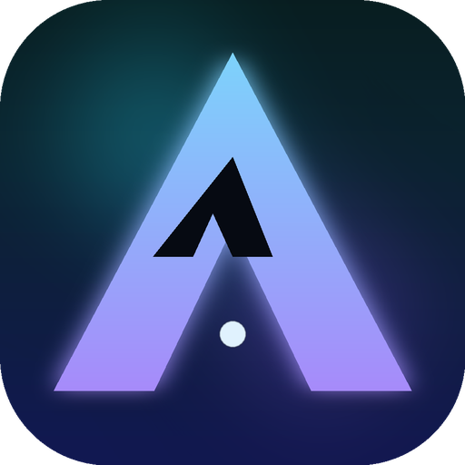
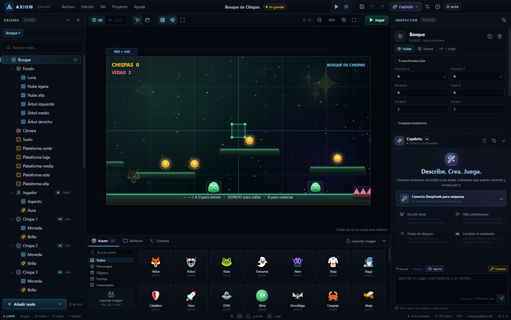
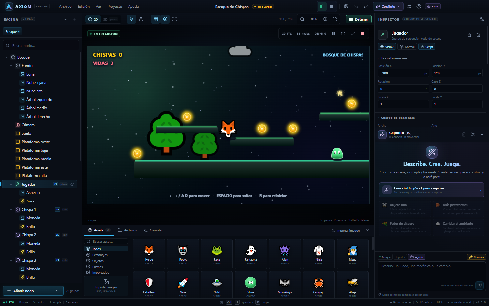
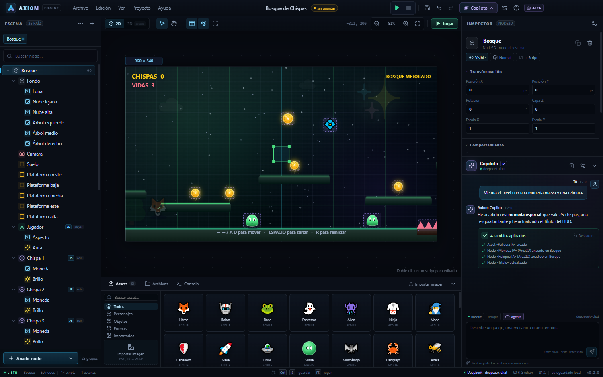
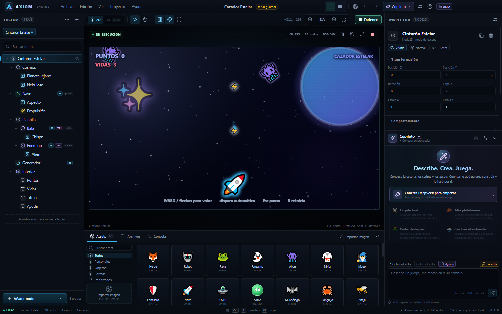
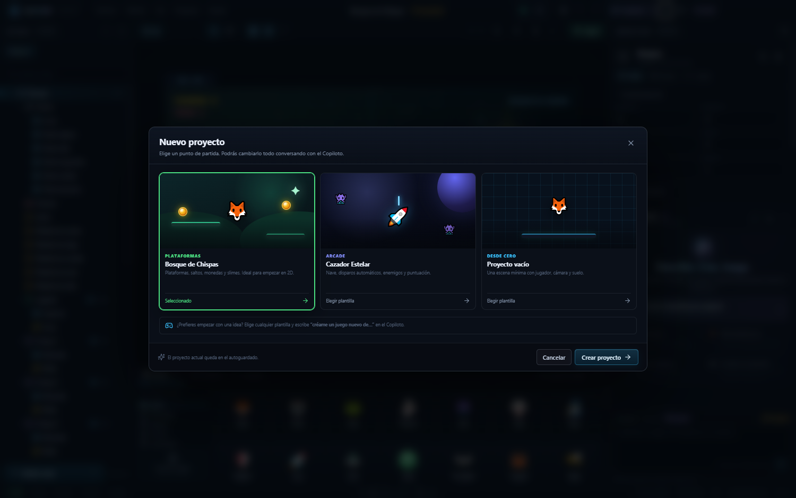
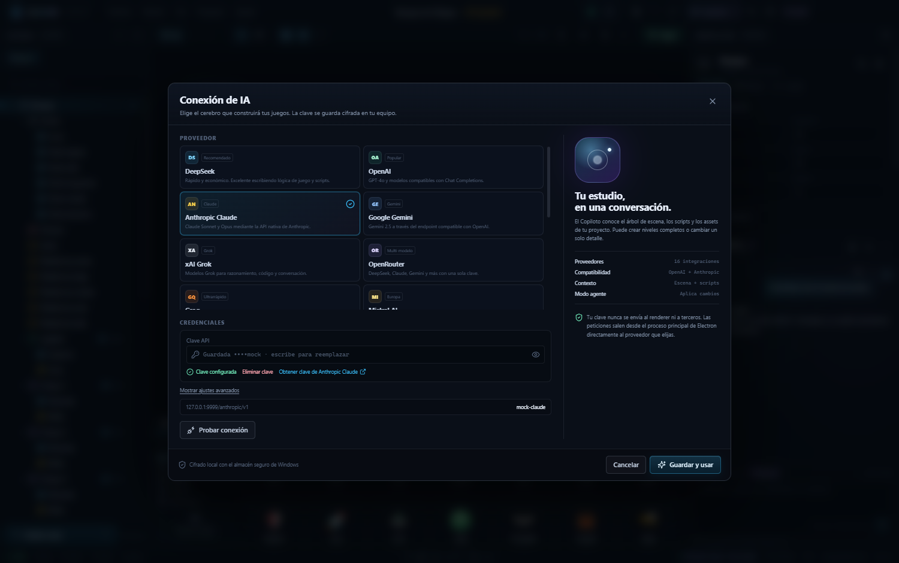

<p align="center">
  
</p>

<h1 align="center">AXIOM ENGINE</h1>

<p align="center">
  Un motor de videojuegos 2D para crear conversando con IA.<br />
  Editor visual, runtime jugable y Copiloto IA multi-proveedor en una sola aplicación de escritorio.
</p>

<p align="center">
  
  
  
</p>

<p align="center">
  <a href="https://github.com/otaplus/axiom-engine">Repositorio</a> ·
  <a href="https://github.com/otaplus/axiom-engine/releases/tag/v0.3.0">Descargar v0.3.0</a> ·
  <a href="docs/SCRIPTING.md">API de scripting</a> ·
  <a href="docs/AI_AGENT.md">Protocolo del agente</a>
</p>



> **Axiom Engine** está inspirado en la filosofía de editores como Godot: árbol de escena, inspector, viewport y scripts. Su diferencia es que el **Copiloto IA** vive dentro del editor y conoce el proyecto: puede crear niveles completos, añadir mecánicas, escribir scripts, generar assets y corregir lo que ya existe.

---

## Lo que ya funciona

| Área | Capacidades |
| --- | --- |
| Editor | Árbol de escena con arrastrar y soltar, inspector, viewport con zoom/pan, cuadrícula, snapping, geometría de colisión, deshacer/rehacer |
| Runtime 2D | Escenas, cámara con seguimiento y suavizado, física AABB, plataformas, áreas de detección, partículas, HUD, pausa, victoria/derrota y reinicio |
| Scripts | Comportamientos en JavaScript con API estilo Godot: `_ready`, `_process`, `_physics_process`, `move_and_slide`, señales, plantillas y proyectiles |
| Assets | Biblioteca de emojis, formas vectoriales, monedas dibujadas por código, importación de imágenes y assets creados por IA |
| IA | Chat con DeepSeek, Claude, Gemini, Groq, Mistral y más; streaming, contexto del proyecto, modo agente y deshacer |
| Proyecto | Guardar/abrir `.axiom`, autoguardado local, múltiples escenas, escena principal y exportación portable |
| Distribución | Instalador de Windows, ZIP portable, paquete Linux `tar.gz`, icono propio y aplicación Electron |
| Actualizaciones | Comprobación automática de GitHub Releases, descarga con progreso, verificación SHA-256 e instalación desde la app |
| Linux | Ventana sin marco con controles propios, paquete `tar.gz` y script de instalación con acceso en el menú |

### Capturas

| Gameplay | Copiloto en acción |
| --- | --- |
|  |  |

| Bienvenida del Copiloto | Shooter de ejemplo |
| --- | --- |
|  |  |

| Plantillas | 16 proveedores de IA |
| --- | --- |
|  |  |

---

## Inicio rápido

### Opción A — Instalador de Windows

1. Descarga [Axiom-Engine-0.3.0-Setup.exe](https://github.com/otaplus/axiom-engine/releases/download/v0.3.0/Axiom-Engine-0.3.0-Setup.exe).
2. Ejecuta el instalador y sigue el asistente. Se instala por usuario, sin necesidad de administrador.
3. Abre **Copiloto → Conectar** y configura tu proveedor de IA.
4. Axiom buscará actualizaciones en GitHub al iniciarse; también puedes hacerlo desde **Ayuda → Buscar actualizaciones…**.

También está disponible el [ZIP portable](https://github.com/otaplus/axiom-engine/releases/download/v0.3.0/Axiom-Engine-0.3.0-x64.zip) si prefieres no instalar.

> La aplicación no está firmada digitalmente en esta etapa alfa. Windows SmartScreen puede pedir confirmación la primera vez. Los checksums SHA-256 se publican junto a cada archivo.

### Opción B — Linux

1. Descarga [Axiom-Engine-0.3.0-x64.tar.gz](https://github.com/otaplus/axiom-engine/releases/download/v0.3.0/Axiom-Engine-0.3.0-x64.tar.gz) y el [instalador de Linux](https://github.com/otaplus/axiom-engine/releases/download/v0.3.0/install-linux.sh).
2. Ejecuta:

```bash
chmod +x install-linux.sh
./install-linux.sh 0.3.0
```

El script instala en `~/.local/share/axiom-engine`, añade el lanzador al menú de aplicaciones y crea `~/.local/bin/axiom-engine`. En Linux el actualizador descarga el paquete nuevo; su instalación es manual.

Requisitos habituales en Ubuntu/Fedora: `libgtk-3`, `libnss3`, `libasound2`, `libgbm1` y `libxshmfence1`. Si usas un entorno mínimo, revisa las dependencias de Electron.

### Opción C — Desarrollo

Requisitos: **Node.js 20 o superior** (probado con Node 24). El desarrollo funciona en Windows y Linux.

```bash
npm install
npm run dev
```

Si la descarga de Electron falla por restricciones de red, define una caché local:

```powershell
$env:ELECTRON_CACHE="$PWD\.cache\electron"
npm install
```

### Comandos

```bash
npm run dev         # editor en modo desarrollo
npm run build       # compila main, preload y renderer
npm start           # previsualiza la build
npm run typecheck   # TypeScript estricto
npm test            # tests del motor y del parser IA
npm run dist:win    # ZIP + instalador de Windows (requiere Inno Setup 6)
npm run dist:linux  # paquete Linux tar.gz en release/
npm run dist:dir    # genera release/win-unpacked sin comprimir
```

Para compilar el instalador de Windows en desarrollo se necesita [Inno Setup 6](https://jrsoftware.org/isinfo.php). El CI de GitHub no está incluido en esta versión.

---

## Crea tu primer juego con IA

1. Elige una plantilla en **Archivo → Nuevo proyecto** o parte de la escena actual.
2. Conecta DeepSeek en **Ajustes de IA** (icono de engranaje).
3. En el Copiloto escribe, por ejemplo:
   - *“Crea un plataformas con doble salto, monedas y un jefe final que dispare.”*
   - *“Convierte este nivel en un templo subterráneo con antorchas y un portal.”*
   - *“Añade una barra de vida al jugador y un ataque cuerpo a cuerpo con la tecla E.”*
4. Mantén **Agente** activo para que los cambios se apliquen automáticamente. Si lo desactivas, revisarás cada propuesta antes de aplicarla.
5. Pulsa **Jugar** (o `F5`) para probar. `Shift+F5` detiene la partida.
6. Guarda con `Ctrl+S` y comparte el archivo `.axiom`.

### Ejemplos incluidos

En [`examples/`](examples/) hay tres proyectos listos para abrir:

- [`bosque-de-chispas.axiom`](examples/bosque-de-chispas.axiom)
- [`cazador-estelar.axiom`](examples/cazador-estelar.axiom)
- [`proyecto-vacio.axiom`](examples/proyecto-vacio.axiom)

### Proveedores de IA incluidos

Axiom incluye presets para los proveedores más conocidos y permite editar la URL base, el modelo y la temperatura:

| Proveedor | Tipo | Modelo inicial |
| --- | --- | --- |
| **DeepSeek** | OpenAI-compatible | `deepseek-chat` |
| **OpenAI** | OpenAI-compatible | `gpt-4o-mini` |
| **Anthropic Claude** | API nativa adaptada | `claude-sonnet-4-5` |
| **Google Gemini** | OpenAI-compatible | `gemini-2.5-flash` |
| **xAI Grok** | OpenAI-compatible | `grok-3` |
| **OpenRouter** | Multi-modelo | `deepseek/deepseek-chat` |
| **Groq** | OpenAI-compatible | `llama-3.3-70b-versatile` |
| **Mistral AI** | OpenAI-compatible | `mistral-large-latest` |
| **Together AI** | OpenAI-compatible | Llama 3.3 70B |
| **Perplexity** | OpenAI-compatible | `sonar-pro` |
| **GitHub Models** | OpenAI-compatible | `openai/gpt-4o-mini` |
| **Hugging Face** | Router OpenAI-compatible | Llama 3.3 70B |
| **Ollama** | Local, sin clave | `llama3.2` |
| **LM Studio** | Local, sin clave | `local-model` |
| **vLLM** | Autoalojado, sin clave | `local-model` |
| **Personalizado** | Cualquier endpoint compatible | — |

Los modelos son solo un punto de partida: puedes escribir otro identificador en los ajustes avanzados. Para Anthropic se usa su API nativa de mensajes (no necesita proxy). Los proveedores locales no requieren clave API.

También se pueden usar las variables de entorno `DEEPSEEK_API_KEY` u `OPENAI_API_KEY` como clave de respaldo.

La clave se guarda cifrada con el almacén seguro del sistema (`safeStorage`) y **nunca se envía al renderer**. Las peticiones salen del proceso principal de Electron directamente al proveedor elegido. No hay telemetría.

### Actualizaciones automáticas

Axiom comprueba **GitHub Releases** unos segundos después de abrirse. Si hay una versión nueva:

1. Muestra un aviso con la versión disponible.
2. Descarga el instalador desde la release con progreso y verificación SHA-256.
3. Al pulsar **Reiniciar e instalar**, cierra Axiom, instala la nueva versión en el mismo directorio y vuelve a abrir la app.

También puedes forzar la comprobación desde **Ayuda → Buscar actualizaciones…**. En Linux el actualizador descarga el `.tar.gz` y abre la carpeta para que lo instales manualmente con el script de Linux. Las releases deben publicarse como versión estable (no como *pre-release*) para que el actualizador las detecte.

---

## Controles del editor

| Acción | Atajo |
| --- | --- |
| Guardar / Guardar como | `Ctrl+S` / `Ctrl+Shift+S` |
| Abrir / Nuevo proyecto | `Ctrl+O` / `Ctrl+N` |
| Deshacer / Rehacer | `Ctrl+Z` / `Ctrl+Y` |
| Duplicar / Eliminar nodo | `Ctrl+D` / `Supr` |
| Reproducir / Detener | `F5` / `Shift+F5` |
| Cuadrícula / Colisiones | `G` / `C` |
| Mover vista | Espacio + arrastrar, o botón central |
| Zoom | Rueda del ratón |
| Renombrar nodo | Doble clic en el árbol |
| Editar script | Doble clic en el nodo del viewport o botón “Editar script” |

Controles de juego por defecto: flechas/WASD, `Espacio` para saltar, `J` para disparar, `Esc` para pausar y `R` para reiniciar. Los scripts pueden consultar o ampliar estas acciones con `Input`.

---

## Cómo funciona

```text
src/main/          Proceso principal de Electron: ventana, API de IA, claves, archivos
src/preload/       Puente seguro y tipado entre Electron y la interfaz
src/renderer/      Editor React + runtime del juego + Copiloto
  engine/          Modelo de proyecto, renderer 2D, físico, scripts, acciones IA
  store/           Estado del editor, chat y ajustes
  components/      Árbol, viewport, inspector, assets, Copiloto y modales
  templates.ts     Juegos de ejemplo jugables
tests/             Tests de acciones, parser, plantillas y scripts
docs/              Documentación técnica y capturas
```

El Copiloto recibe un resumen estructurado del proyecto (escena, árbol, props y scripts) y responde con una explicación más un bloque `<acciones>` en JSON. El renderer valida y aplica esas acciones de forma transaccional, con historial para deshacer. El motor no depende de React: el runtime se puede ejecutar sobre un canvas independiente.

Más detalles:

- [Arquitectura](docs/ARCHITECTURE.md)
- [API de scripting](docs/SCRIPTING.md)
- [Protocolo del agente IA](docs/AI_AGENT.md)

---

## Scripting

Los scripts son clases implícitas: solo escribes métodos. Ejemplo de jugador:

```js
_ready() {
  this.speed = 300
  this.jump = 720
}

_physics_process(dt) {
  const dir = Input.get_axis("left", "right")
  this.velocity.x = dir * this.speed
  this.velocity.y += this.gravity * dt

  if (Input.is_action_just_pressed("jump") && this.on_floor) {
    this.velocity.y = -this.jump
    this.play_sound("jump")
  }

  this.move_and_slide(dt)
}
```

El runtime expone `Game`, `Input`, `print`, `rand`, `clamp`, `lerp`, `dist`, `Vector2`, sonidos sintetizados y una API de nodo (`get_node`, `spawn`, `overlaps`, `queue_free`, `shake`). Consulta la [referencia completa](docs/SCRIPTING.md).

---

## Estado del proyecto

Axiom 0.3.0 es una **alfa funcional**. Es un motor real y jugable, pero no pretende sustituir todavía a Godot en proyectos grandes.

### Incluido

- Editor visual 2D completo para el flujo asistido por IA.
- Dos juegos de ejemplo jugables y una plantilla vacía.
- Física, cámara, HUD, partículas, sonido sintetizado y scripts.
- IA con contexto, streaming, agente y deshacer.
- Instalador de Windows, autoactualización desde GitHub y paquete Linux.
- Aplicación portable en ZIP.

### Próximos pasos

- Exportación de juegos a HTML/Web y ejecutable independiente.
- Modo 3D básico.
- Editor de animaciones y tilemaps.
- Depurador visual, breakpoints y perfilador.
- AppImage y paquetes `.deb` para Linux, además del `tar.gz` actual.

### Limitaciones conocidas

- Solo 2D; la pestaña 3D está marcada como “pronto”.
- No hay editor de audio ni importación de música.
- Los scripts se ejecutan localmente con el runtime del editor; están pensados para proyectos propios.
- En Linux se distribuye un `tar.gz` portable con script de instalación; aún no hay AppImage ni `.deb`.
- La autoactualización instala en Windows. En Linux descarga el paquete y la instalación es manual.
- El instalador de Windows no está firmado digitalmente.

---

## Tests y calidad

```bash
npm run typecheck
npm test
```

La suite actual cubre:

- Serialización, normalización y migración de proyectos.
- Creación y modificación de nodos mediante el protocolo de acciones.
- Validación y ejecución de scripts.
- Extracción del bloque de acciones del Copiloto.
- Compilación de todos los scripts de las plantillas.

También existen pruebas end-to-end con Electron que se ejecutan manualmente porque necesitan abrir una ventana:

```bash
node scripts/e2e.mjs          # editor, juego, IA y proveedores
node scripts/test-updater.mjs # actualización simulada, descarga y checksum
node scripts/test-packaged.mjs # build empaquetada y comprobación de GitHub
```

---

## Licencia

MIT. Consulta [LICENSE](LICENSE).
